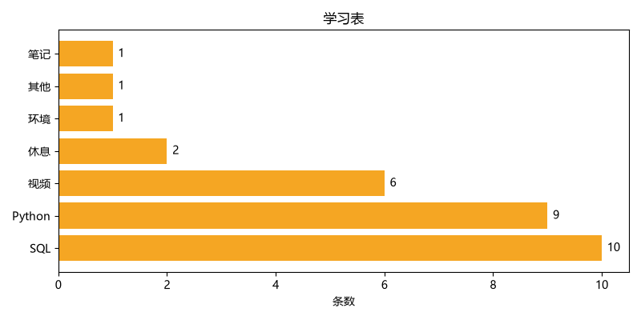
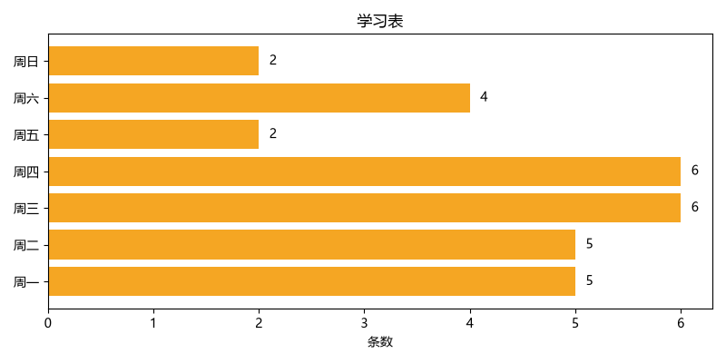

# 学习时间统计分析

> 用自己的学习记录（`data/study_log.csv`）做的一次完整数据分析：
> 读数据 → 体检 → 按 **科目 / 周几 / 日期** 三个维度汇总 → 出图 → 存盘。

---

## 一、数据是什么

- **来源**：`data/study_log.csv`
- **规模**：**30 行 × 5 列**（日期 / 周几 / 科目 / 分钟 / 内容）
- **时间跨度**：**13 天**（2026-09-14 ~ 2026-09-26）
- **科目**：7 类 —— SQL / Python / 视频 / 休息 / 环境 / 其他 / 笔记
- **合计**：**1830 分钟**

### 毛病（数据本身缺什么）

- **样本很小**：只有 13 天、30 行，结论只适合描述这两周，不能外推
- **日期没有年份**：原数据是 `"9/14"` 这种字符串，直接转会被当成"公元 1 年"，
  必须手动补 `2026/` 再指定格式转成真日期
- **各周几记录数不均**：周五只有 2 条，周三、周四各 6 条 —— 做"按周几"对比时要注意
- **30 行里内容唯一值只有 29**（有一句重复记录），不影响总量

---

## 二、怎么跑

在项目根目录 `E:\ai\interview-analysis` 下执行：

```
.venv\Scripts\python.exe src/project/学习时间统计.py
```

（在 PyCharm 里直接右键这个文件 → Run 也一样）

运行后会在 `output/` 下生成本文件第四节列出的全部图表和数据。

---

## 三、结论 3 条

### ① 周五的两个 0 分钟，是我自己定的休息日

13 天里只有 **2 天**总分钟为 0，分别是 **9/18 和 9/25** —— 两天都是**周五**。

```
  日期         周几   科目   分钟
  2026-09-18   周五   休息    0
  2026-09-25   周五   休息    0
```

**结论**：不是漏记，是"周五休息"这条规矩真实地写进了数据里。
所以分析时要**保留**这两行（删掉的话，"平均每天多少分钟"就会被高估）。

### ② 视频：次数少，但单次耗时最长

| 科目 | 条数 | 总分钟 | 平均 | 时间占比 |
|---|---|---|---|---|
| SQL | 10 | 630 | 63.0 | 34.4% |
| Python | 9 | 580 | 64.4 | 31.7% |
| **视频** | **6** | **480** | **80.0** | **26.2%** |
| 环境 | 1 | 60 | 60.0 | 3.3% |
| 其他 | 1 | 40 | 40.0 | 2.2% |
| 笔记 | 1 | 40 | 40.0 | 2.2% |
| 休息 | 2 | 0 | 0.0 | 0.0% |

**结论**：视频只有 6 次（**次数占比 20%**），但时间占比 **26.2%** ——
因为它**每次都是 80 分钟，是全部科目里单次最长的**。
「次数少、单次耗时长」是它和其他科目最大的区别。

> ⚠️ 这里有个口径问题：**次数占比 20%** 和 **时间占比 26.2%** 是两回事。
> 做时间统计必须按**时间**算占比；按次数算，这个结论就消失了。

### ③ 周六单次最长，但样本太小

```
  周三：6 次，合计 410 分钟，平均 68.3   ← 总量最多
  周六：4 次，合计 330 分钟，平均 82.5   ← 单次最长
```

**结论**：周六的平均单次时长最高（82.5 分钟），**但它只有 4 条记录**。
样本越小，均值越容易被一两次特例拉高 —— 所以这个"最高"必须连着样本量一起说，
不能单独拿出来当结论。相比之下，**「周三总量最多（410 分钟，6 次）」更稳。**

---

## 四、产出物

| 文件 | 内容 |
|---|---|
| `output/学习统计_科目.csv` | 7 行：科目 / 条数 / 总分钟 / 平均 / 占比% |
| `output/学习统计_周几.csv` | 7 行：周一 ~ 周日 / 条数 / 总分钟 / 平均 |
| `output/学习时间分析.xlsx` | 2 个 sheet（科目 / 周几），Excel 打开可直接看 |
| `output/科目_个数.png` | 横向条形图：各科目的记录条数 |
| `output/周几_个数.png` | 横向条形图：周一到周日的记录条数 |





---

## 五、踩过的坑（留着给下一个项目看）

```
  ①  日期是 "9/14" 字符串
        pd.to_datetime("9/14")                     → 公元 1 年
        pd.to_datetime("9/14", format="%m/%d")     → 1900 年
        正解：pd.to_datetime("2026/" + 日期, format="%Y/%m/%d")

  ②  「相差几天」≠「有几天」
        .max() - .min()            → timedelta，12 天（跨度，不含起点）
        nunique() / len(unique())  → 13 个日期（个数）
        13 根柱子之间只有 12 段间隔 —— 典型差一（off-by-one）

  ③  groupby("周几") 默认按汉字编码排序
        → 周一 周三 周二 周五 周六 周四 周日（乱的）
        → 正解：.reindex(["周一","周二",...,"周日"]) 明确指定顺序

  ④  占比口径
        ["分钟"].count()  → 次数占比（错）
        ["分钟"].sum()    → 时间占比（对，做时间统计要用这个）
```

---

*项目 B ｜ 2026-10-24 ｜ 数据：自己的 30 天学习记录*
