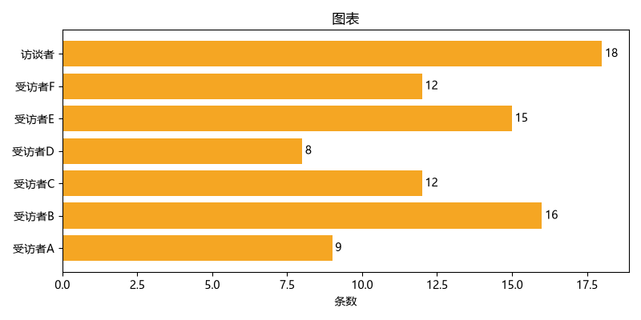
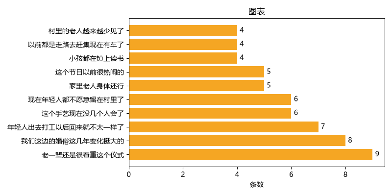

# 访谈语料分析
## 一、数据是什么
    2 个 CSV 合并 90 条访谈，7 个说话人（6 个受访者 + 1 个访谈者）
  内容：手艺 / 婚俗 / 打工 / 节日 / 老人

    毛病：重复度高 —— 90 条里只有 22 条独立文本（重复 68 行，76%）；
        访谈者 18 条全是陈述句，不是提问
  
## 二、怎么跑
      .venv\Scripts\python.exe src/project/访谈语料分析.py

## 三、结论 3 条
  ①  90条里面只有22条是不一样的，重复度高

  ②  同一句话被多个人说过 ——
    22 句里有20句是多个人提到的，所以重复不是噪音，是 共同的共识

  ③  访谈者 18 条全是陈述句，可能是引导性提问（陈述式提问）

## 四、产出物
|文件| 内容                |
|---|-------------------|
| output/访谈_说话人.csv | 7 行：每人条数/字数/平均/占比 |
| output/访谈_话题.csv   | 22 行：每条话被说几次、几个人说 |
| output/访谈_分析.xlsx  | 2 个 sheet（说话人 / 话题） |
| output/访谈_说话人.png | 条形图：每人条数          |
| output/访谈_话题.png   | 条形图：Top10 被说次数    |

[点我](https://example.com) 
